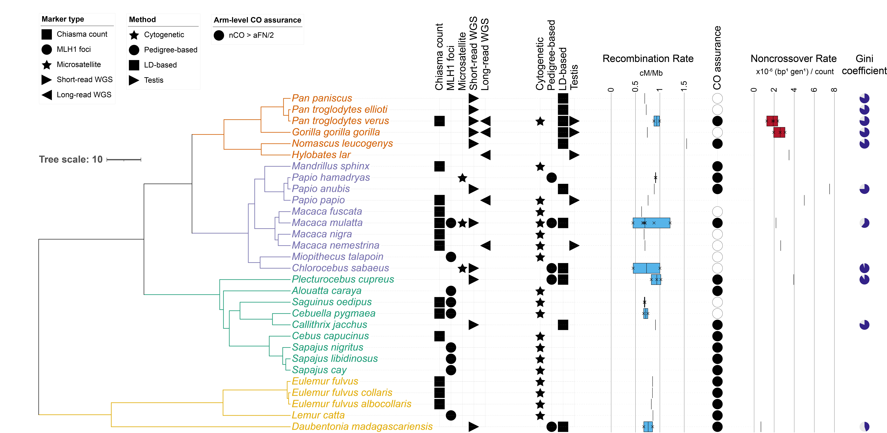

# Figure 1: Phylogeny with cM/Mb, Gini, and NCO annotations



## Caption

**Figure 1. Genome-wide recombination rate, fine-scale unevenness (Gini coefficient), and non-crossover rate across 30 non-human primate species, mapped onto clade structure and data provenance.**

Species tree (TimeTree.org divergence estimates, with manually-added divergence times for two subclades TimeTree could not resolve — see Methods) for all species with published or newly computed recombination data assembled in this review; branch and tip-label color indicates major clade (Apes, orange; Cercopithecidae, purple; Platyrrhini, teal; Strepsirrhini, gold).

Symbol columns (left to right) indicate, per species: Method (the analytical approach used to estimate recombination — cytogenetic chiasma or MLH1-foci counting, pedigree-based direct transmission counting, LD-based population-scaled inference, or long-read testis haplotype-switch detection) and Marker Type (the underlying raw data type — chiasma counts, immunofluorescent MLH1 foci, microsatellite genotyping, short-read whole-genome sequencing, or long-read sequencing), both ordered left to right by the chronology of the underlying technology. Filled symbols indicate presence; blank cells indicate no data of that type for that species; shape distinguishes category, not color.

Recombination Rate: genome-wide cM/Mb, boxplot spanning the minimum-to-maximum of all available published or independently recomputed estimates per species (individual estimates marked ×; the box is not a statistical distribution, since studies differ by method rather than representing repeated sampling of one population).

Gini: fine-scale recombination-rate unevenness, computed raw/unbinned from each available fine-scale genetic map (Lorenz-curve Gini coefficient; 0 = perfectly even, 1 = maximally uneven), shown as the filled proportion of a circle. For species with more than one available estimate, a single representative value was selected (see Supplemental Table S2).

Noncrossover Rate: genome-wide non-crossover (gene conversion) rate per base pair per generation (×10⁻⁶), boxplot as above. Values derive from two structurally different approaches — direct pedigree transmission counts (Papio anubis, Daubentonia madagascariensis, Macaca mulatta, Plecturocebus cupreus) and model-based estimates from pooled germline long-read sequencing (Pan troglodytes verus, Gorilla gorilla gorilla, Hylobates lar, Papio papio, Macaca nemestrina); cross-reference the Method column to distinguish these, as they are not the same kind of measurement despite sharing units. Species without a box have no published non-crossover data.

Blank cells throughout the figure reflect genuine gaps in the primate recombination literature (e.g., LD-based and cytogenetic methods cannot detect non-crossover events at all), not incomplete data collection. Full per-study values, references, and derivation notes are provided in Supplemental Tables S1-S3.

## Files

| File | Contents |
|---|---|
| `Figure_1_Final_101626.jpg / .svg` | Final figure (iTOL export, finished in Illustrator) |
| `iTOL_datasets/` | iTOL annotation files (clade colors, method/marker symbols, cM/Mb and NCO boxplots, Gini pie charts, arm-assurance) and supplemental tables S1-S3 as CSV |

## Regenerate

Run from the repository root:

Rebuild the iTOL annotation files from `Central_Comparison_Table.xlsx`:

```bash
for s in Scripts/figure1_phylogeny_itol/build_itol_*.py; do python3 "$s"; done
```

Then upload `Scripts/figure1_phylogeny_itol/Primates.nwk` and the files in `iTOL_datasets/` to [iTOL](https://itol.embl.de/) and export.
